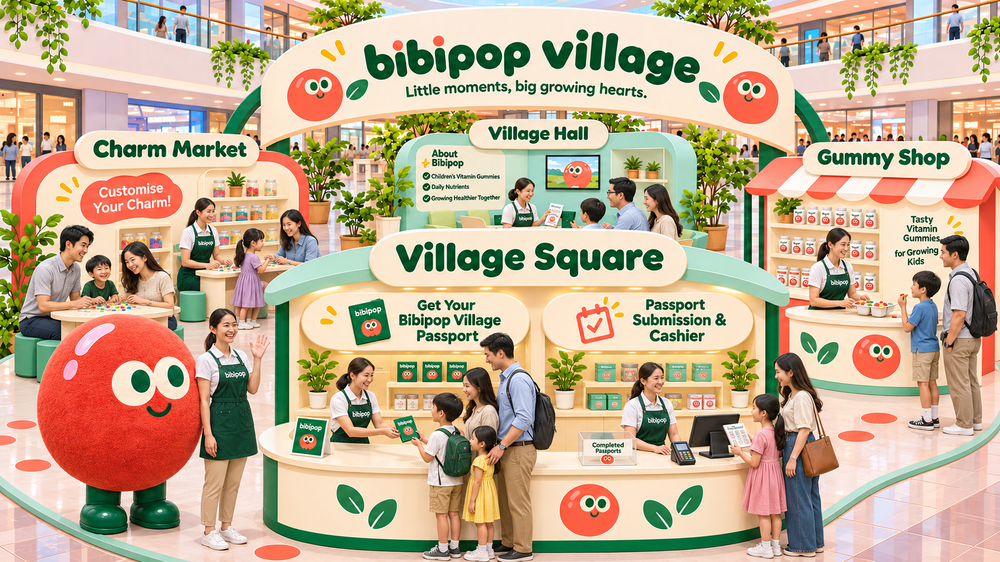

# bibipop! · Little moments, big growing hearts

bibipop! is our Singapore Management University capstone consulting project for Sisterhood. We propose a children's vitamin gummy brand built around a daily routine parents can feel confident about and children can help make their own. This interactive project submission brings together the brand, subscription experience, go-to-market strategy, communications, launch campaign and our consulting journey.

**[Explore the bibipop! website](https://owenlim112.github.io/bibipop-submission/)**



## Exploring the project

Select any of the six illustrated objects to zoom into its chapter, or choose **Follow the Project** to read them in order. Within a chapter, use the section navigation and chapter selector to move around. **Overview** returns to the illustrated map.

Core recommendations remain visible. Supporting research insights, calculations and examples can be expanded where needed. Tables present costs, prices, scenarios and planning assumptions with exact figures. The site is a project submission and interactive prototype; subscriptions and event activities are proposals.

## The six chapters

### 1. Meet bibipop!

[Explore chapter](https://owenlim112.github.io/bibipop-submission/#brand/0) · [Read chapter PDF](https://owenlim112.github.io/bibipop-submission/assets/bibipop-brand-guidelines.pdf)

Meet the brand and the two audiences it speaks to: parents looking for reassurance and children who want to take part in the daily routine.

- **Brand foundations:** the brand story, purpose, positioning and personality.
- **Visual identity:** the colour palette, typography, primary and icon logos, approved variations, clear space and usage guidance.
- **Voice & Bibi:** the tone of voice, original mascot artwork, expressions and character variations used across the experience.

### 2. Subscription Box

[Explore chapter](https://owenlim112.github.io/bibipop-submission/#subscription/0) · [Read chapter PDF](https://owenlim112.github.io/bibipop-submission/assets/bibipop-subscription-box.pdf)

A monthly gummy refill and changing family activity turn the subscription into a shared routine. The reusable squishy bottle gives children something they can personalise and keep using.

- **Explore the Kit:** an expanded interactive space-themed box, a squeezeable 3D bottle and activity booklet, followed by the main bibipop! colour design and its top-down contents.
- **Monthly additions:** 30-gummy refill pouches, first-month keychains, 12 activity ideas, examples and estimated cost ranges.
- **Box planning:** packing workflows, in-house and part-time fulfilment options, capacity bands and labour assumptions.
- **Print and assembly:** exterior and interior previews, a 200 × 130 × 50 mm box, A2 and tiled A4 printing, and assembly instructions. [Download the box template and guidelines](https://owenlim112.github.io/bibipop-submission/assets/box-dimensions-and-template.pdf).

### 3. GTM Strategy

[Explore chapter](https://owenlim112.github.io/bibipop-submission/#strategy/0) · [Read chapter PDF](https://owenlim112.github.io/bibipop-submission/assets/bibipop-gtm-strategy-final.pdf)

The 4Ps connect parent insights with decisions about the offer, how families discover it, where they can try or buy it, and what they pay.

- **Interactive 4Ps map:** select Product, Promotion, Place or Price. Original Bibi artwork identifies the Product island and the first checkpoint on the overview's treasure map.
- **Product and trust:** positioning, differentiation, clear product information and an experience children can take part in.
- **Promotion and Place:** parent creators, professional expertise, educational content, direct customer relationships and opportunities to experience the product.
- **Price and viability:** subscription plans, selling prices, contribution margins, revenue scenarios and monthly and annualised volumes, presented in tables with assumptions.
- **Parent research:** expandable insights explain the reasoning behind each recommendation and the questions that still need validation.

### 4. Marketing & Communications

[Explore chapter](https://owenlim112.github.io/bibipop-submission/#marketing/0) · [Read chapter PDF](https://owenlim112.github.io/bibipop-submission/assets/bibipop-marketing-communications.pdf)

Follow the communication plan from a parent's first encounter with bibipop! through product understanding, reassurance and purchase consideration.

- **Audience and objectives:** the target parent segment, communication needs and measurable objectives.
- **Content pillars:** Little Everyday Moments, What's Inside, and Parents Ask, We Answer, with topics and suitable formats.
- **Channel execution:** social and digital content, KOL and parent-creator profiles, paid media and campaign mockups.
- **Calendars and measurement:** the 12-week launch plan, annual organic and paid media schedules, and funnel KPIs.

### 5. bibipop! Village Launch

[Explore chapter](https://owenlim112.github.io/bibipop-submission/#village/0) · [Read chapter PDF](https://owenlim112.github.io/bibipop-submission/assets/bibipop-village-launch.pdf)

A family pop-up introduces the brand through play, product discovery and conversations with parents. The four-booth layout shows how the experience could fit into a mall atrium.

- **Village Explorer:** visit Village Square, Charm Market, Gummy Shop and Village Hall to see each booth's design, purpose and activities.
- **Interactive Village Passport:** flip through the illustrated pages, follow the booth route, collect stamps and discover the Village Chief completion badge.
- **Campaign Marketing:** a dedicated four-week plan with weekly calls to action, deliverables, event-day content, a channel schedule and a S$7,500 marketing allocation.
- **Operations and costings:** setup, staffing, consumables, variable costs, offers and financial assumptions. Budget notes identify overlapping allowances and items that need reconciliation before spending.

### 6. Our Journey

[Explore chapter](https://owenlim112.github.io/bibipop-submission/#journey/0) · [Read chapter PDF](https://owenlim112.github.io/bibipop-submission/assets/bibipop-our-journey.pdf)

Reflect on how we applied **#Empathy** and **#FeelAlive**, balancing ideas that excited us with what families would enjoy and Sisterhood could deliver.

- **Montigo collaboration:** the partnership idea, proposed responsibilities and why the concept was parked.
- **Village development:** the move from nine areas to four booths, with concept comparisons and the reasoning behind the simpler layout.
- **Subscription development:** early mockups and the progression from activity ideas to box design, costing, packing and fulfilment.
- **Peek at Our Thinking:** the questions, constraints and trade-offs behind the recommendations, followed by the team's closing reflection and thanks.

## Using the site

The site uses **HTML, CSS and JavaScript**, with **Three.js/WebGL** for the 3D models. A desktop browser provides the fullest interactive experience. Responsive layouts support smaller screens, and keyboard focus, labelled controls, reduced-motion support and scrollable tables help make the submission easier to navigate.

| File or folder | Purpose |
| --- | --- |
| `index.html` | Main interactive submission |
| `assets/` | Artwork, fonts, 3D resources, six chapter PDFs and box-printing guidelines |
| `exports/` | Flat passport artwork |
| `passport.html` | Standalone interactive passport |
| `README.md` | Chapter guide and PDF links |
| `.nojekyll` | Serves the prepared files directly on GitHub Pages |

All chapter PDF links above open the files directly through GitHub Pages, bypassing the repository file preview. The PDFs are also included in this repository. Keep the `assets/` folder alongside `index.html` and `README.md` when copying or uploading the site.

### Run locally

From the repository root, run:

```bash
python -m http.server 8000
```

Then open [localhost:8000](http://localhost:8000).

### Publish to GitHub Pages

1. Extract the GitHub Pages ZIP. In GitHub Desktop, select the existing `bibipop-submission` repository on `main`, then fetch and pull.
2. Copy the extracted contents into the repository root, including `.nojekyll`, while preserving the `assets/` and `exports/` folders.
3. Commit and push to `main`. In **Settings → Pages**, select **Deploy from a branch**, `main` and `/(root)`.
4. Check the [published site](https://owenlim112.github.io/bibipop-submission/) and chapter PDF links after deployment.

## Team and credits

Created by **Ang Bin Heng, Giselle Tan, Isabelle Tay, Owen Lim, Reimi Ho and Zhang Xintong** for our Singapore Management University capstone project.

*Our Capstone Project, With Love ♥*
